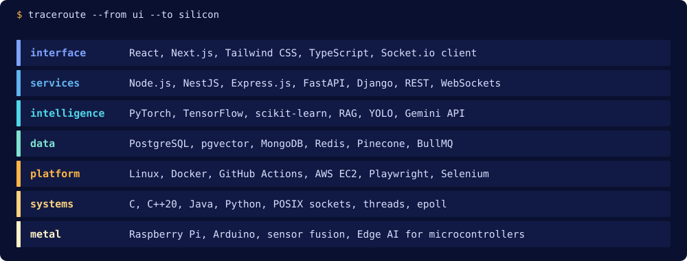
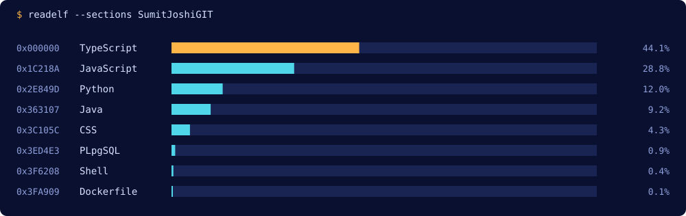

# Sumit Joshi: Software Developer

Software engineer from Dehradun, India, and a B.Tech Computer Science (AI & ML) student at Graphic Era Hill University, class of 2027. I build production-style web applications, real-time systems and RAG pipelines, and I'm working my way down the stack with a C++ web server written from scratch.

[Portfolio](https://portfolio.sumit99k.tech/) | [LinkedIn](https://www.linkedin.com/in/sumitjoshi99k/) | [Email](mailto:git.sumitjoshi@gmail.com)

## Contribution activity

<!-- stats:start -->
**369** contributions in the last 12 months, **738** since 2023, across **52** active days in the last year. Longest streak: **6** days. Top language: **TypeScript**.
<!-- stats:end -->

## Projects

| Project | What it is | Built with |
| --- | --- | --- |
| [Pacer](https://github.com/SumitJoshiGIT/Pacer-preview) ([live](https://apps.pacer.sumit99k.tech)) | Codebase intelligence platform with a RAG bot that gives cited answers, ownership graphs and technical debt heatmaps, ingesting 500+ webhooks/min | Next.js, NestJS, PostgreSQL, pgvector, BullMQ |
| Nox (in progress) | Dependency-free HTTP server, reverse proxy and load balancer | C++20, POSIX sockets |
| [Maestro](https://github.com/SumitJoshiGIT/Chess) | Multiplayer chess platform with matchmaking and live board synchronization | Next.js, TypeScript, PostgreSQL, Socket.io |
| Hellum | Autonomous campus tour robot with sensor fusion, 95% obstacle avoidance accuracy and RAG answers to location queries in under 2 seconds | Python, Raspberry Pi, Pinecone, Gemini API |
| [Lavender](https://github.com/SumitJoshiGIT/cozy-chatroom-MERN) ([live](https://apps.lavender.sumit99k.tech)) | Real-time chat application with JWT authentication, load-tested to 8,000 concurrent WebSocket connections | MongoDB, Express.js, React, Node.js, Socket.io |
| [E2EE Chat](https://github.com/SumitJoshiGIT/E2EE_CHAT) | End-to-end encrypted messaging using the Signal Protocol | Java, JavaFX, Spring Boot, MongoDB |
| [Distributed Task Runner](https://github.com/SumitJoshiGIT/distributed_task_runner) | Credit-based marketplace where distributed workers claim and process data chunks | React, TypeScript, Express.js |

## Skills

Skills as text

- **Languages:** Python, TypeScript, JavaScript, C, C++, Java, SQL
- **Frontend:** React, Next.js, Tailwind CSS, responsive UI
- **Backend:** Node.js, NestJS, Express.js, FastAPI, Django, Socket.io, REST APIs, WebSockets
- **AI and machine learning:** PyTorch, TensorFlow, scikit-learn, RAG pipelines, vector search, computer vision, YOLO, Gemini API
- **Data:** PostgreSQL, pgvector, MongoDB, Redis, Pinecone, BullMQ
- **Platform and testing:** Linux, Docker, GitHub Actions, CI/CD, AWS EC2, Playwright, Selenium
- **Systems and hardware:** POSIX sockets, threads, epoll, Raspberry Pi, Arduino, Edge AI

## Research and achievements

- Published research paper (2025): *V-IPDS: Vision-based Insect Predator Detection for Beehive Monitoring using YOLOv11n*
- IEEE Matrix Hackathon finalist (2025): led a 4-member team to the finals
- Graphethon 2.0 finalist (2024): national-level hackathon with 500+ participants

---

Visuals are generated daily by [`scripts/generate.py`](scripts/generate.py) from public GitHub data.
